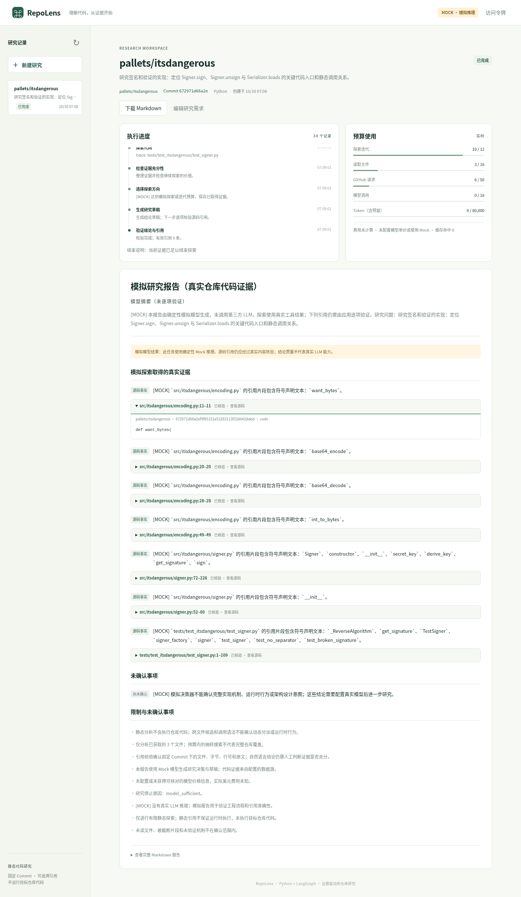
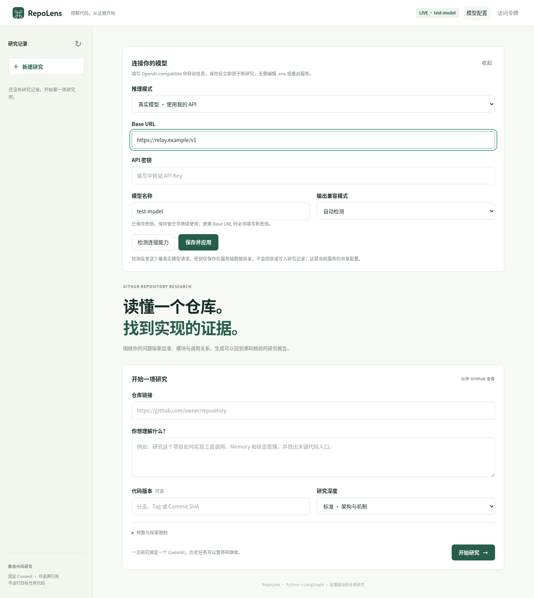
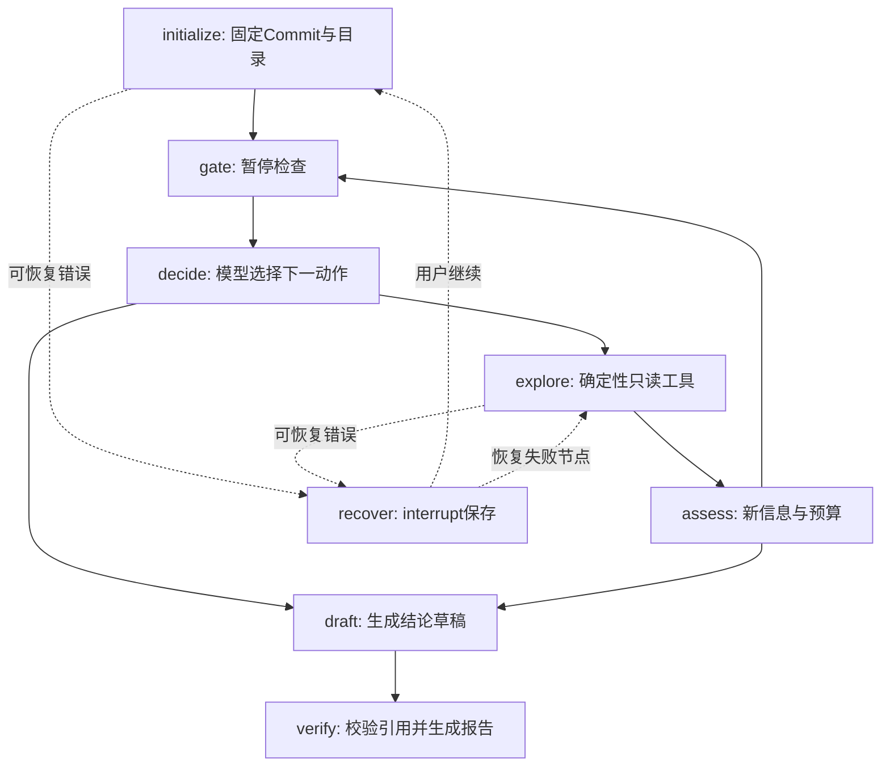

# RepoLens · GitHub Repository Research Agent

用 Python、LangGraph 和真实源码证据研究 GitHub 开源项目。输入仓库 URL 和研究问题，Agent 在预算内选择文件、搜索符号、追踪静态引用，并输出绑定到固定 Commit 的研究报告。

项目提供 FastAPI Web UI、CLI、SQLite Checkpointer、不可变源码缓存以及第三方 OpenAI-compatible 模型适配层。默认 `Mock` 模式不调用 LLM；GitHub 数据仍通过官方 REST API 获取。Mock 报告会明确标注为模拟研究。

公开源码仓库：[GimMoliyadi/github-use-agent](https://github.com/GimMoliyadi/github-use-agent)。

[](https://github.com/GimMoliyadi/github-use-agent/actions/workflows/ci.yml)



[实际验收记录](docs/validation.md) · [带永久链接的研究示例](docs/validation/targeted-report.md) · [手机截图](docs/screenshots/mobile.png) · [架构与恢复机制](docs/architecture.md)

## 快速开始

需要 Python 3.11+ 和 [uv](https://docs.astral.sh/uv/)。

```bash
git clone https://github.com/GimMoliyadi/github-use-agent.git
cd github-use-agent
uv sync --frozen --extra dev
cp .env.example .env
uv run repo-research serve --host 127.0.0.1 --port 8000
```

Windows 原生 PowerShell（已安装 Git；uv 可自动获取 Python）：

```powershell
powershell -ExecutionPolicy ByPass -c "irm https://astral.sh/uv/install.ps1 | iex"
# 安装完成后重新打开 PowerShell，再执行：
git clone https://github.com/GimMoliyadi/github-use-agent.git
cd github-use-agent
uv sync --frozen --extra dev
Copy-Item .env.example .env
uv run repo-research serve --host 127.0.0.1 --port 8000
```

已有目录更新时，先 Ctrl+C 停止服务，执行 `git pull --ff-only` 和
`uv sync --frozen --extra dev`，再运行上述启动命令；保留 `.env` 和 `data/`。

打开 <http://127.0.0.1:8000>。填写 `https://github.com/pypa/sampleproject`，提出“研究项目的 Python 入口、打包配置与模块关系”，点击开始。页面显示主要步骤、资源预算、带永久源码链接的报告和历史任务；手机与电脑均可使用。

URL 必须是仓库根地址；分支、标签或 Commit 写在单独的 Ref 输入框。任务初始化后解析为完整 Commit SHA，此后读文件和引用都绑定该版本。

```bash
uv run repo-research research https://github.com/pypa/sampleproject \
  --question "研究 src/sample/__init__.py 中 main 函数及其入口配置" \
  --depth standard --output data/sample-report.md
uv run repo-research list
uv run repo-research resume TASK_ID --output data/resumed-report.md
```

`research` 运行中按 Ctrl+C 会请求在节点边界暂停并保存；关闭 Web 服务后，可重新启动并从历史记录继续。不要删除 `data/`，也不要同时让 Web 和另一个 CLI 研究进程使用同一数据目录。

## 接入第三方模型中转站

推荐直接在 Web 页顶部点击 **“模型配置”**，填写 Base URL、API 密钥和模型名称，选择“真实模型”。点击“检测连接能力”可验证聊天、工具调用和 JSON Schema，然后点击“保存并应用”。保存后无需重启，新研究立即使用该配置。

密钥不会回显或写入浏览器存储、研究历史；配置保存到服务端 `DATA_DIR/model-settings.json`，POSIX 权限为 `0600`，Windows 继承数据目录的 NTFS 权限，重启后自动恢复。该文件包含明文密钥，应随服务器私有数据保护，已被 Git 和 Docker 构建忽略。此界面管理的是当前服务的共享模型配置；公开服务仍需设置 `APP_ACCESS_TOKEN`。有任务运行时先暂停或完成，再修改配置。保留原 Base URL 时密钥留空可复用，修改 Base URL 必须填写新密钥。



检测不成功时查看页面显示的阶段和 HTTP 状态：401/403 对应认证或权限，404 需核对接口前缀与模型名称，429 需核对配额或限流，5xx 对应服务端异常。连接失败或超时应检查运行服务机器的网络、代理及证书。Base URL 填服务商提供的接口前缀（例如 `https://relay.example/v1`），不要填完整 `/chat/completions` 或 `/responses`；模型名称必须是中转站实际支持的模型 ID。

聊天通过而工具调用、JSON Schema 不支持时，可选择自动兼容或 JSON 文本模式；这表示聊天连接可用，后续生成仍需满足 JSON 校验。检测会显示额外诊断，但不会展示服务商原始错误正文，以免泄露凭据。聊天回显验证失败表示已收到响应但未通过语义验证，需要确认模型输出可用文本。

CLI 和环境变量方式也保留。保存的 Web 配置优先于环境变量中的模型配置；CLI 默认读取它，显式 `--mode mock` 可忽略已保存配置。模型检测按钮会发送少量真实请求，不会自动保存，Mock 模式不访问模型 API。

在本地 `.env` 中配置自己的服务；该文件被 Git 忽略。项目不预设 DeepSeek 官方地址，不自动更换提供商。

```dotenv
MODEL_MODE=live
LLM_BASE_URL=https://your-provider.example/v1
LLM_API_KEY=your-key
LLM_MODEL=your-model-name
LLM_OUTPUT_MODE=auto
LLM_TIMEOUT=45
LLM_MAX_RETRIES=1
```

先执行能力检测，再开始真实模型研究：

```bash
uv run repo-research probe --mode live
uv run repo-research research https://github.com/pypa/sampleproject \
  --question "解释 sample.main 的实现与打包入口" --mode live
```

`probe` 使用配置的中转站真实请求，分别验证普通聊天、工具调用和 JSON Schema 输出，并计入模型调用与 Token 预算。研究也会在首次使用时检测能力。工具调用和结构化输出不可用时，可退回经过 Pydantic 校验的 JSON 文本；认证失败、网络错误等不会被伪装成成功或切换到其他 API。`MODEL_MODE=live` 缺少三项必要配置时直接拒绝启动。

若中转站仅支持聊天补全，可设置 `LLM_OUTPUT_MODE=json_text`；能力探测仍会显式检查可选协议。详细环境变量见 [.env.example](.env.example)。没有真实密钥时，使用 `MODEL_MODE=mock` 完成可复现的工程验证；Mock 不证明真实模型的推理质量或服务兼容性。

## Agent 如何研究

主要工作流在 [agent.py](src/repo_research/agent.py) 中使用实际 `StateGraph` 编排：



图展示主要正常分支和恢复机制；其他节点也通过统一包装处理错误。探索工具包括文件片段读取、有限范围文本搜索、Python AST 符号索引以及静态调用/导入候选追踪。模型负责决策与结论草稿；工具负责实际数据读取，应用负责预算、证据 ID 和永久链接。

循环会因模型认为证据足够、最大迭代、文件/字节/API/模型/Token/费用预算、重复动作或连续无新信息而结束。模型预算耗尽时保存有限证据报告，清楚说明尚未完成语义研究。完整说明见 [架构文档](docs/architecture.md)。

## 证据与静态分析边界

每条证据包含仓库、完整 Commit SHA、相对文件路径、Git Blob SHA、LF 行号范围、原文和 GitHub 永久链接。引用通过完整下载文本、字节数、Git SHA、行号、原文和程序生成的 URL 校验；无有效引用的结论会降级为未确认，只由文档/配置支持的实现事实会降为推断。

报告区分事实、推断和未知。引用存在且准确，并不自动证明自然语言解释充分；结论仍需要读者结合代码判断。Python AST 可解释函数、类、导入和调用语法；动态分派、反射、运行时状态及其他语言的精确调用图不在初版保证范围内。

项目只进行静态分析。不会克隆并执行目标代码、安装目标依赖或执行 README 中的命令。仓库 README、注释和代码均作为不可信数据处理。模型不获得 shell 或任意网络工具。

## GitHub 访问与预算

使用 `api.github.com` 官方 REST，默认支持公开仓库。可配置可选 `GITHUB_TOKEN` 提高 API 额度；项目不自动读取其他工具的 `GH_TOKEN`。REST metadata/branch 解析不会永久缓存；Git Tree、Blob 和固定 Commit 的完整文本持久缓存。

大型仓库先读取目录树，再根据问题选择代码。GitHub 递归树被截断时进行有限的分层遍历；Git Trees API 没有分页接口，未探索目录和截断会明确显示为限制。过滤生成目录、二进制文件和超出大小预算的内容，保持 UTF-8 完整性，不把部分文件当作完整源码。API 请求、失败与重试都计入预算。

| 深度 | 探索轮数 | 文件数 | GitHub 请求 | 模型调用 | Token | 下载字节 |
| --- | ---: | ---: | ---: | ---: | ---: | ---: |
| quick | 6 | 6 | 20 | 11 | 40,000 | 180,000 |
| standard | 12 | 16 | 50 | 18 | 80,000 | 400,000 |
| deep | 24 | 32 | 100 | 32 | 160,000 | 900,000 |

Web UI 支持自定义预算；CLI 可使用 `--max-iterations`、`--max-files`、`--max-api-requests`、`--max-llm-calls`、`--max-tokens` 和 `--max-cost-usd`。默认费用预算为 $2，但只有同时配置 `LLM_INPUT_PRICE_PER_MILLION` 和 `LLM_OUTPUT_PRICE_PER_MILLION` 时才可估算和执行美元预算；未配置价格显示“费用未知”，模型调用和 Token 预算仍有效。预算是应用的保守限制，服务商最终账单仍以其实际计费为准。

## 测试与真实验证

离线测试使用确定性的模型和 `httpx.MockTransport`，不访问 GitHub 或付费模型：

```bash
uv run pytest -m "not live and not browser"
uv run ruff check .
```

真实 GitHub 测试需显式开启；真实源码访问与 Mock 推理分开标记：

```bash
RUN_LIVE_TESTS=1 uv run pytest -m live
RUN_LIVE_TESTS=1 uv run python examples/check_live.py --output-dir data/live-validation
```

验证脚本研究 `pypa/sampleproject` 的项目结构与 `sample.main`，使用独立缓存从 GitHub 固定 Commit 重新读取每条引用的完整文件，检查路径、Blob SHA、行号、原文和永久链接，并保存 Markdown 和 `results.json`。脚本强制 Mock，即使本地 `.env` 配置了 live，也不会调用真实 LLM。

浏览器验收可使用 Playwright 的 Chromium 或指定已安装的浏览器：

```bash
uv run playwright install chromium
RUN_BROWSER_TESTS=1 uv run pytest tests/test_web.py -m browser -q
RUN_LIVE_TESTS=1 RUN_BROWSER_TESTS=1 uv run python examples/check_ui_live.py
# 使用系统 Chromium 时，增加 CHROMIUM_EXECUTABLE_PATH=/usr/bin/chromium
```

前者使用模拟任务数据验证启动、暂停、恢复、历史与手机布局；后者启动实际服务，研究真实 `pallets/itsdangerous`，保存截图、报告和结构化执行记录，推理仍为 Mock。

测试覆盖 URL 校验、固定版本、缓存、截断目录、文件大小/二进制/完整性、API 故障与速率限制、探索预算、引用校验和中断恢复。已实际执行离线测试、真实 GitHub API 研究、Chromium 桌面/手机浏览器交互和 Docker 非 root 运行；GitHub Actions 的 Python 3.11 离线检查也已通过。完整命令、结果和验证边界见 [验收记录](docs/validation.md)。没有真实 LLM 凭据，模型协议通过真实适配器和 MockTransport 验证，尚未验证第三方服务或真实模型推理质量。

## 项目结构与部署

```text
src/repo_research/
  agent.py              LangGraph节点、动态路由、暂停与恢复
  github.py             固定Commit的只读GitHub REST访问
  github_cache.py       SQLite不可变数据缓存
  llm.py                中转站适配、能力探测、Mock和模型预算
  tools.py              有限搜索、代码证据、Python AST静态分析
  report.py             引用验证与报告渲染
  storage.py/service.py 任务历史、资源账本和线程工作队列
  web.py/static/        FastAPI与无构建步骤的响应式Web UI
  cli.py                启动、研究、历史、恢复及协议检测
```

[部署文档](docs/deployment.md) 提供 Docker、持久卷、访问令牌和单进程配置。公开部署应设置 `APP_ACCESS_TOKEN`，避免其他人使用你的模型额度或读取研究历史。当前使用本地 SQLite 与单服务进程；同一数据目录只允许一个服务拥有者，不支持多副本分布式调度。

后续开发先读 [AGENTS.md](AGENTS.md) 和 [PROGRESS.md](PROGRESS.md)，运行离线检查，再继续未完成任务。项目使用 [MIT License](LICENSE)。
